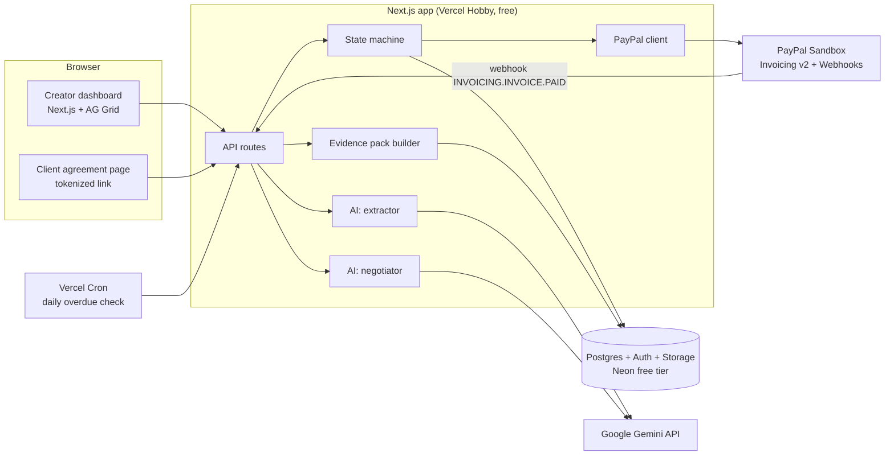
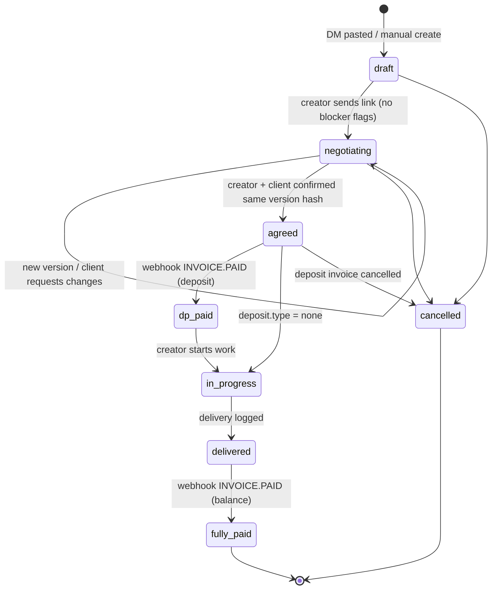
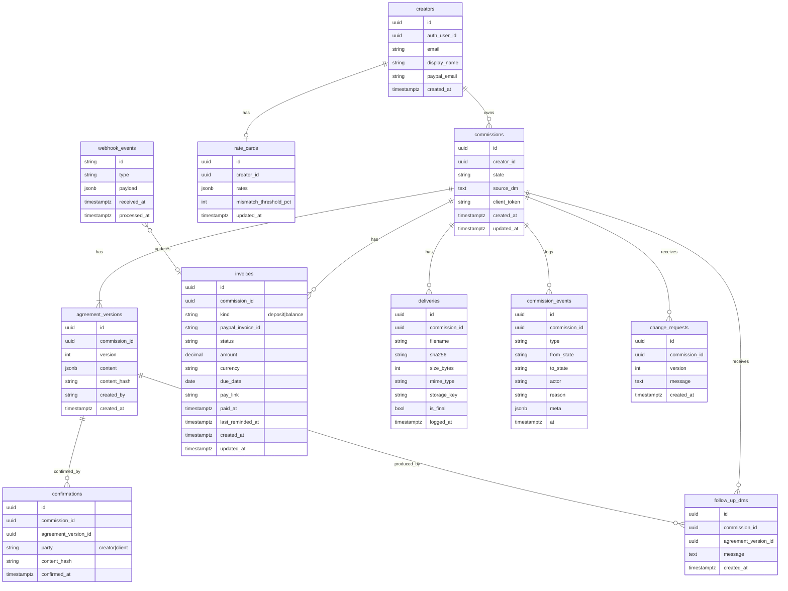
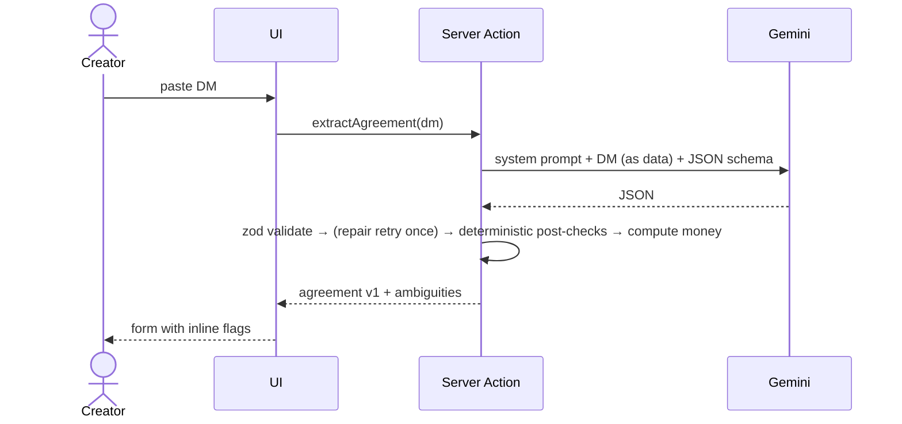
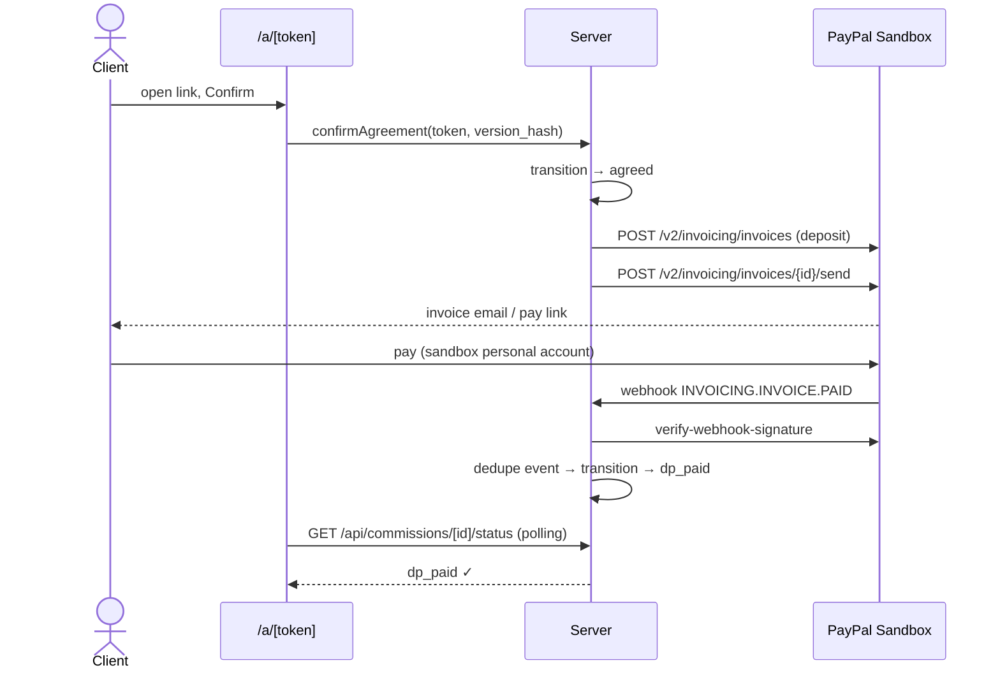

# DMpact — Architecture

| | |
|---|---|
| **Status** | Draft, not yet reviewed by the team |

## 1. System overview



One deployable Next.js app holds both UI and API. Every boundary that talks to an external service sits behind a module (`lib/ai/*`, `lib/paypal/*`) so it can be mocked in tests and demos.

## 2. Folder layout

```
dmpact/
├── docs/                      # PRD, URD, schema, architecture, timeline
├── schema/                    # agreement + negotiation JSON Schema (generated from zod)
├── scripts/                   # generate-json-schema.ts
├── prisma/                    # schema.prisma, migrations, seed.ts
├── prisma.config.ts
├── fixtures/dms/              # fake commission DMs + expected JSON
├── evals/                     # extraction + negotiation eval runners
├── public/
└── src/
    ├── proxy.ts               # Neon Auth route protection
    ├── generated/prisma/      # Prisma Client (git-ignored)
    ├── app/
    │   ├── (auth)/login/
    │   ├── (creator)/
    │   │   ├── layout.tsx     # creator shell, redirects if logged out
    │   │   ├── page.tsx       # home
    │   │   ├── commissions/
    │   │   │   ├── page.tsx   # AG Grid queue
    │   │   │   ├── new/       # paste DM
    │   │   │   └── [id]/      # detail, timeline, actions.ts
    │   │   └── settings/rate-card/
    │   ├── a/[token]/         # client agreement page
    │   └── api/
    │       ├── auth/[...path]/  # Neon Auth handler
    │       ├── webhooks/paypal/
    │       ├── cron/overdue/
    │       └── commissions/[id]/
    │           ├── status/    # polling
    │           └── evidence/  # PDF download
    ├── components/            # ui/ (atoms), molecules/, organisms/, templates/
    ├── hooks/                 # use-polling.ts, ...
    └── lib/
        ├── db.ts
        ├── env.ts             # validated env vars
        ├── auth/              # server.ts, client.ts, getCurrentCreator()
        ├── repositories/      # server-only data access, one file per domain
        ├── storage.ts         # S3 client for Neon Object Storage
        ├── schema/            # zod: agreement, negotiation, forms
        ├── state-machine/
        ├── money/
        ├── ai/                # gemini.ts, extract/, negotiate/
        ├── paypal/
        └── evidence/
```

Unit tests sit next to the code they test (`*.test.ts`).

Creator pages, Server Actions, and API routes check the user with `getCurrentCreator()` (Neon Auth `auth.getSession()`). The client page, PayPal webhook, and cron route are protected by the token, webhook signature, and `CRON_SECRET`.

## 3. Commission state machine



| Transition | Trigger | Guard | Side effect |
|---|---|---|---|
| draft → negotiating | Creator | No `blocker` ambiguities, valid agreement | Generate client token |
| negotiating → agreed | Client confirm | Valid agreement, both confirmations on the same `content_hash` | Create + send deposit invoice |
| agreed → dp_paid | PayPal webhook | Verified signature, invoice = this commission's deposit | — |
| dp_paid → in_progress | Creator | — | — |
| in_progress → delivered | Delivery upload | ≥ 1 delivery log entry, valid agreement | Create + send balance invoice (skip if balance = 0 → straight to fully_paid) |
| delivered → fully_paid | PayPal webhook | Verified, invoice = balance invoice | — |
| * → cancelled | Creator | State before dp_paid | Cancel open PayPal invoices |

All transitions go through one function, `transition(db, { commissionId, to, actor, reason }, handlers)`, which checks the guard, writes a `commission_events` row, and runs side effects. Nothing else updates `commissions.state`.

A valid agreement passes `agreementSchema`, has a total and currency, and has a deposit no larger than the total.

## 4. Data model



`agreement_versions`, `confirmations`, `deliveries`, `commission_events`, and `follow_up_dms` are append-only, enforced by database triggers. A trigger also keeps `commissions.source_dm` from changing.

The agreement in force is the latest version both parties confirmed. A deadline change after client approval adds a new version, and the previous one stays in force until the client re-confirms. Re-confirming doesn't change the commission state.

## 5. Key sequences

### 5.1 Paste DM → agreement



### 5.2 Client confirms → deposit invoice → paid



### 5.3 Overdue reminders

Vercel Cron (once a day, plus a manual "Run now" button for the demo) calls `GET /api/cron/overdue` with `Authorization: Bearer $CRON_SECRET`. For each unpaid invoice past `due_date` and not reminded in 24 h: `POST /v2/invoicing/invoices/{id}/remind`, generate an AI nudge message, store it on the commission, and set `last_reminded_at`.

## 6. Environments and config

| Env var | Used by |
|---|---|
| `DATABASE_URL` | Prisma Client at runtime (Neon pooled connection, host contains `-pooler`) |
| `DIRECT_URL` | Prisma CLI / migrations via `prisma.config.ts` (direct connection) |
| `NEON_AUTH_BASE_URL`, `NEON_AUTH_COOKIE_SECRET` | Neon Auth (creator login) |
| `AWS_ENDPOINT_URL_S3`, `AWS_REGION`, `AWS_ACCESS_KEY_ID`, `AWS_SECRET_ACCESS_KEY` | Neon Object Storage (delivery files, server only) |
| `GEMINI_API_KEY`, `GEMINI_MODEL`, `GEMINI_FALLBACK_MODEL` | AI modules |
| `PAYPAL_CLIENT_ID`, `PAYPAL_CLIENT_SECRET` | PayPal client |
| `PAYPAL_API_BASE` = `https://api-m.sandbox.paypal.com` | PayPal client |
| `PAYPAL_WEBHOOK_ID` | Webhook signature verification |
| `APP_BASE_URL` | Client links, PayPal invoice notes |
| `CRON_SECRET` | Vercel Cron → `/api/cron/*` auth |

Local dev receives PayPal webhooks through a tunnel (ngrok / cloudflared) or the PayPal webhook simulator. The polling fallback means the demo still works without either.

## 7. Testing strategy

| Layer | What | Tool |
|---|---|---|
| Unit | Money math, state machine guards, post-check rules, agreement diff | Vitest |
| AI evals | Extraction on `fixtures/dms` (field accuracy, ambiguity recall). Negotiation on mismatch cases | `evals/` scripts, run manually + nightly |
| Integration | State machine against a test database (`*.integration.test.ts`, needs `TEST_DATABASE_URL`) | Vitest |
| Integration | PayPal client against sandbox (create/send/get/cancel) | Vitest, tagged `@sandbox`, not run in CI |
| E2E | Paste → fully paid happy path, plus 3 edge paths | Playwright, or a manual checklist if time is short (Marsha) |
